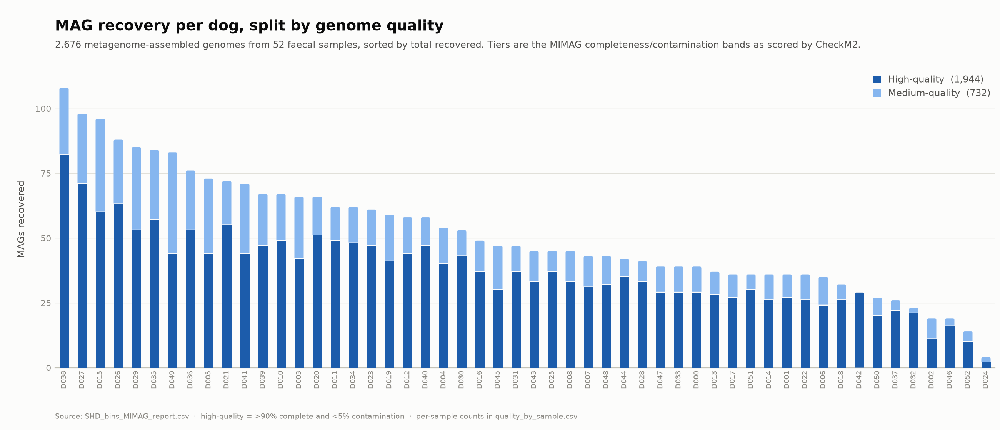
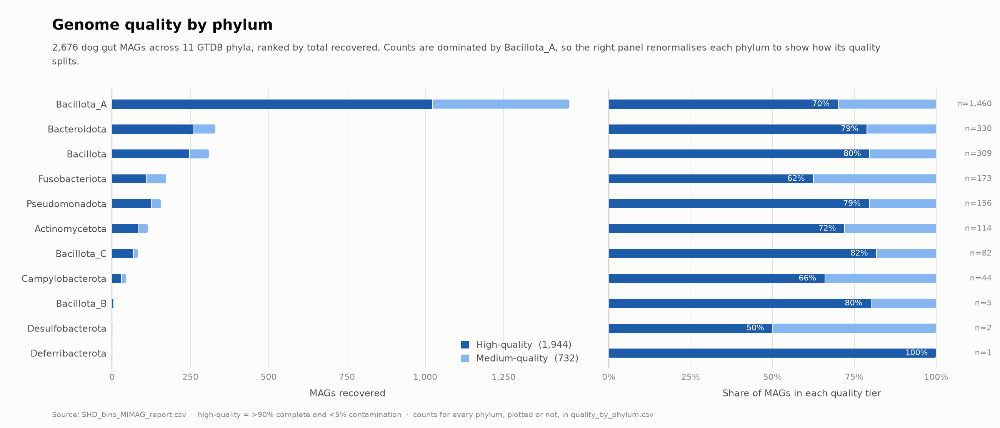
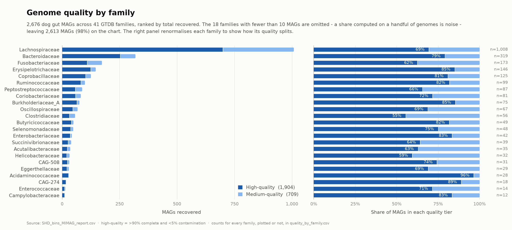
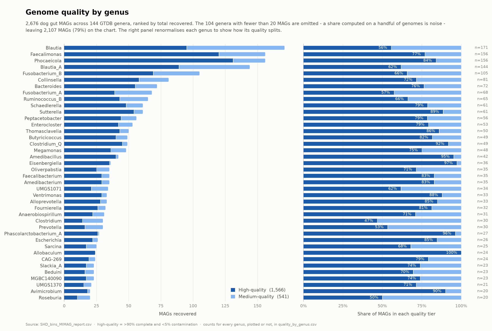
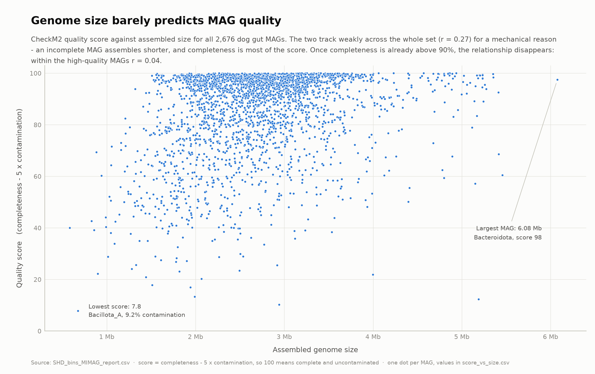
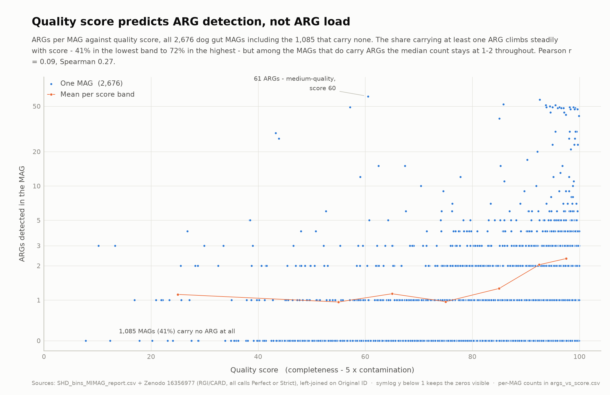

# Dog gut MAG dataset — structure and first look

Working notes on the dog metagenome-assembled genome (MAG) dataset from the
[vibe-workshops](https://github.com/luispedro/vibe-workshops) intro session.

The dataset arrived with only a short email for documentation, so the first job
was working out the schema. [`data.md`](data.md) is the result: the full column
reference, the rules behind the two derived columns, and the gotchas that bite
if you take the table at face value.

## Contents

| Path | What it is |
|---|---|
| [`data.md`](data.md) | **Start here** — data dictionary for the MAG table |
| `data/SHD_bins_MIMAG_report.csv` | 2,676 MAGs × 20 columns (CheckM2 stats + GTDB-Tk taxonomy) |
| `data/dataset_email.txt` | The original note describing the dataset |
| `data/ARGs/SHD1_ARGs_MAGs.csv.gz` | RGI/CARD ARG calls, 4,702 hits over 1,591 MAGs ([Zenodo 16356977](https://zenodo.org/records/16356977)) |
| `figures/` | Rendered charts, light and dark, plus the underlying counts (`*.csv`) |
| `scripts/` | Profiling and plotting scripts — every number in `data.md` is reproducible |

## Two things worth knowing up front

- **The `MIMAG` column uses non-standard thresholds.** It requires ≥20 distinct
  tRNAs rather than the published standard's 18, and does not require 5S rRNA at
  all. Use the column as given rather than recomputing it from the standard.
- **`GTDBtk fastani Ref` uses the string `0` to mean "no match"**, not an empty
  cell — 470 rows, exactly the rows whose species is unassigned.

Full details and six more gotchas in [`data.md`](data.md).

## Reproducing

Needs `pandas` and `matplotlib`.

```sh
# column profile and the checks behind data.md
python3 scripts/profile_data.py   data/SHD_bins_MIMAG_report.csv
python3 scripts/check_relations.py data/SHD_bins_MIMAG_report.csv
python3 scripts/check_mimag.py    data/SHD_bins_MIMAG_report.csv
python3 scripts/confirm_rule.py   data/SHD_bins_MIMAG_report.csv
python3 scripts/summary.py        data/SHD_bins_MIMAG_report.csv

# the figures
python3 scripts/plot_quality_by_sample.py \
    data/SHD_bins_MIMAG_report.csv \
    figures/quality_by_sample.png \
    figures/quality_by_sample_dark.png \
    figures/quality_by_sample.csv

# one per taxonomic rank: phylum | class | order | family | genus
for rank in phylum family genus; do
    python3 scripts/plot_quality_by_taxonomy.py \
        data/SHD_bins_MIMAG_report.csv "$rank" \
        "figures/quality_by_$rank.png" \
        "figures/quality_by_${rank}_dark.png" \
        "figures/quality_by_$rank.csv"
done

python3 scripts/plot_score_vs_size.py \
    data/SHD_bins_MIMAG_report.csv \
    figures/score_vs_size.png \
    figures/score_vs_size_dark.png \
    figures/score_vs_size.csv

python3 scripts/plot_args_vs_score.py \
    data/SHD_bins_MIMAG_report.csv \
    data/ARGs/SHD1_ARGs_MAGs.csv.gz \
    figures/args_vs_score.png \
    figures/args_vs_score_dark.png \
    figures/args_vs_score.csv
```

## MAG recovery per dog



Recovery is very uneven — 4 to 108 MAGs per sample, median 46 — but the
high-quality share stays fairly stable (50–100%, median 74%) and barely tracks
total yield (r = −0.27). The low-yield dogs are producing *fewer* genomes, not
systematically worse ones.

## Genome quality by taxonomy

`scripts/plot_quality_by_taxonomy.py` takes the rank as an argument and works at
any of phylum / class / order / family / genus. Each chart pairs absolute counts
with the renormalised share, because counts at every rank are lopsided enough to
render the rare taxa sub-pixel. Below phylum the tail is long and a share
computed on three genomes is noise, so each rank has a minimum-n cut (family
≥ 10, genus ≥ 20); the CSV always lists **every** taxon with a `plotted` flag,
so the omitted ones are reported rather than lost.

### Phylum



All 2,676 MAGs are Bacteria over 11 phyla, every row assigned. The counts are
lopsided — Bacillota_A alone is 1,460 of them (55%) — but quality looks flat:
every phylum with ≥ 20 MAGs sits between 62% and 82% high-quality.
Fusobacteriota (62%) and Campylobacterota (66%) are the weak ends, and the
dominant Bacillota_A (70%) is itself below the dataset average of 73%, so the
phyla that bin most abundantly are not the ones that bin best. The three
single-digit phyla should be read as anecdotes.

### Family



23 of 41 families clear the ≥ 10 cut, covering 2,613 MAGs (98%). Lachnospiraceae
is 1,008 MAGs on its own — 38% of the dataset — at 69% high-quality.
**Clostridiaceae (55%, n=56) and Helicobacteraceae (59%, n=32) are the problem
families**; Acidaminococcaceae (96%, n=28), Burkholderiaceae_A and
Erysipelotrichaceae (both 85%) sit at the top.

### Genus



40 of 144 genera clear the ≥ 20 cut, covering 2,107 MAGs (79%). This is where the
variation actually lives: **Clostridium is 47% high-quality (n=30) and Roseburia
50% (n=20), against Eisenbergiella at 97% (n=36) and Amedibacillus at 95%
(n=42)**. Note that *Blautia*, the single most abundant genus (n=171), is one of
the worst at 56%, while its sibling Blautia_A manages 62% — the dominant
Lachnospiraceae lineages are the hardest ones to bin cleanly.

### Quality variation is a genus-level property

Holding the comparison to taxa with ≥ 20 MAGs at every rank, the spread in
high-quality share widens sharply as you go down the tree:

| Rank | Taxa (n ≥ 20) | High-quality share | Spread |
|---|---|---|---|
| Phylum | 8 | 62–82% | 19 pts |
| Family | 20 | 55–96% | 41 pts |
| Genus | 40 | 47–100% | 53 pts |

Phylum-level aggregation hides most of it. If you need a quality expectation for
a lineage, take it from the genus table, not the phylum one.

## Quality score against genome size



Quality score here is the usual CheckM2 penalty, `Completeness - 5 ×
Contamination`, so 100 means complete and uncontaminated. One dot per MAG, no
subsetting.

Across the whole set score and size track weakly (r = 0.27), but that is
mechanical rather than biological: an incomplete MAG assembles shorter, and
completeness is most of the score. The medium-quality MAGs are both smaller and
lower-scored (median 2.35 Mb / 66.5) than the high-quality ones (2.76 Mb /
96.0), and that gap between the two groups is where nearly all of the
correlation comes from.

**Within the high-quality MAGs the relationship is flat** — r = 0.04, and median
score by size quintile goes 96.4 / 95.9 / 95.4 / 95.4 / 97.0 from the smallest
fifth to the largest. So once a genome is past 90% complete, its size tells you
nothing about how good the bin is, and a size filter is not a quality filter.

Two things to read off the shape rather than the statistics: the hard ceiling at
100 (41% of all MAGs score ≥ 95, so the top band is saturated — use
`score_vs_size.csv` if you need density inside it), and the sparse bottom-left,
where small *and* bad is rare — the worst bins are mostly normal-sized genomes
carrying contamination, like the 7.8-scoring Bacillota_A at 9.2%.

The dots are deliberately **not** coloured by the `Quality` column: that column
is derived from completeness and contamination, so colouring by it would spend
the identity channel redrawing a threshold the y position already shows.

## ARGs carried against quality score



Antimicrobial-resistance gene calls come from
[Zenodo 16356977](https://zenodo.org/records/16356977) (`SHD1_ARGs_MAGs.csv.gz`,
RGI/CARD), 4,702 hits over 1,591 MAGs. The join and its two traps are documented
in [`data.md`](data.md#companion-table-dataargsshd1_args_magscsvgz) — in short,
join on `Original ID` (the `Bin ID` columns differ by a `.fna.gz` suffix and
match zero rows), and **left**-join, because the 1,085 MAGs carrying no ARG are
absent from the file and an inner join would silently discard 41% of the data,
all of it zeros.

The y axis is symlog below 1: 97% of MAGs carry ≤ 5 ARGs but the tail runs to
61, so a linear axis would compress almost everything into the bottom of the
panel, and a log axis could not show the zeros at all.

**The signal is in detection, not in load.** The share of MAGs carrying at least
one ARG climbs steadily with quality score:

| Quality score | MAGs | Carrying ≥ 1 ARG | Mean ARGs | Median among carriers |
|---|---|---|---|---|
| ≤ 50 | 133 | 41% | 1.12 | 2 |
| 50–60 | 125 | 31% | 0.95 | 1 |
| 60–70 | 177 | 43% | 1.14 | 1 |
| 70–80 | 278 | 45% | 0.96 | 1.5 |
| 80–90 | 430 | 54% | 1.26 | 1 |
| 90–95 | 429 | 63% | 2.04 | 1 |
| 95–100 | 1,104 | 72% | 2.31 | 2 |

Carriage rises from ~41% to 72%, but the median count *among carriers* never
moves off 1–2. Pearson r is only 0.09 while Spearman is 0.27 — the relationship
is in the zero/non-zero split, not in the magnitude.

**Read this as detection bias, not biology.** A more complete genome is simply
more likely to have its ARG-bearing contig recovered, so an apparent association
between genome quality and resistance carriage is what you would expect even if
every genome carried the same genes. Genome size correlates with ARG count more
strongly than quality score does (r = 0.40 vs 0.09), pointing the same way.
Comparing ARG prevalence across taxa or samples without controlling for
completeness will manufacture differences.
